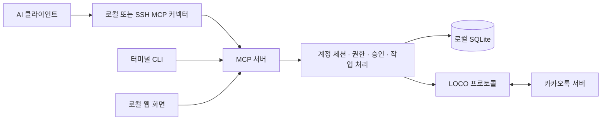

# kakao-mcp-ccomajeon

**개발·관리: [ccomajeon](https://github.com/ccomajeon)**

카카오톡 계정 하나를 Linux 서버의 데몬에 연결하고, AI·터미널·웹에서 사용하는 비공식 MCP 서버입니다. AI는 허용된 대화를 조회하고 메시지를 보낼 수 있으며, 사람은 방별 권한과 승인 절차로 접근을 제어합니다.

**현재 버전:** `0.2.0-rebuild.3` · **Node.js:** 22.18 이상 · **기본 도구:** 16개 · **전체 도구:** 41개

## 어떻게 개발했나요?

TypeScript와 Node.js로 구성하며, 계정 연결·권한·저장·MCP·CLI·웹을 역할별 모듈로 나누었습니다. 패킷 처리, 실시간 메시지 버퍼, 승인 정책과 배포 구성을 다음과 같이 구현합니다.

- **TypeScript 모노레포:** npm workspaces로 통신·계정 처리·클라이언트·실행 앱을 나눕니다.
- **프로토콜 처리:** LOCO 패킷의 헤더·길이·정수 범위를 검사하고 BSON 본문을 직렬화·역직렬화합니다. 잘린 패킷과 잘못된 입력은 오류로 거부합니다.
- **실시간 메시지:** 용량이 제한된 원형 버퍼에 수신 이벤트를 넣고 커서로 새 항목을 조회합니다. 커서는 메모리상의 위치이며 재시작 후 보존되는 체크포인트가 아닙니다.
- **권한과 저장:** 계정 세션·SQLite 저장소·방별 읽기/전송 정책·승인·중복 요청 처리를 core에 모읍니다.
- **보안 개선:** 승인 응답 재사용, 방 읽기 상한, 웹 사진 표시, 링크 미리보기의 주소 검증을 강화했습니다.
- **배포:** esbuild로 실행 프로그램 10개를 ESM 파일에 번들링합니다. 배포 패키지는 별도의 런타임 의존성 다운로드 없이 설치할 수 있으며, 웹 정적 파일과 의존성 라이선스 고지를 포함합니다.
- **검증:** Node 테스트 러너로 단위·격리 통합 테스트를 실행하고, TypeScript 검사와 실제 패키지 설치·명령 실행 검사로 확인합니다.

| 디렉터리 | 역할 |
|---|---|
| `packages/protocol` | LOCO/BSON, 암호화, 기기 등록·인증, 통신과 미디어 송수신 |
| `packages/core` | 단일 계정 세션, SQLite, 접근 정책, 승인과 쓰기 작업, 이벤트·기록 관리 |
| `packages/client` | 데몬에 연결하는 클라이언트 SDK |
| `apps/mcp` | MCP 도구, 승인 연결, 설치·진단·업데이트, SSH 커넥터 |
| `apps/cli` | 터미널 메신저와 명령행 작업 |
| `apps/web` | 로컬 웹 화면, API, 실시간 화면 갱신 |
| `scripts` | 패키지 빌드·설치 검증, 저장소 공개 전 검사 |

## 어떤 방식으로 동작하나요?



1. **사람이 계정을 연결합니다.** 설치 마법사에서 로그인 정보를 입력하고 휴대폰의 기기 인증 요청을 직접 승인합니다.
2. **데몬 하나가 계정 연결을 유지합니다.** AI·CLI·웹은 이 데몬에 요청합니다. 각각 별도 카카오톡 계정 세션을 열지 않습니다.
3. **core가 접근을 검사합니다.** 활성 도구 묶음, 방 읽기 규칙, 전송 허가, 운영자 상한·속도 제한을 적용하고, 필요한 작업은 사람에게 승인을 요청합니다.
4. **승인된 작업을 실행합니다.** 쓰기 작업은 UUID `requestId`와 함께 기록합니다. 같은 요청을 재확인할 때 ID를 유지해 중복 전송을 방지합니다. 결과가 불명확하면 새 ID로 다시 보내지 않습니다.
5. **결과를 클라이언트에 반환합니다.** 수신 메시지는 로컬 저장과 이벤트 처리에 반영됩니다. 조회 결과의 요약·답장 작성은 연결한 AI가 담당합니다.

데몬과 웹은 기본적으로 loopback에서만 접근합니다. 다른 컴퓨터의 AI나 웹 클라이언트는 SSH로 연결합니다. 자체 AI 모델·상시 자동응답 실행기·예약 스케줄러는 포함하지 않습니다.

## 어떤 기능이 있나요?

| 영역 | 기능 |
|---|---|
| 대화 조회 | 방·친구 검색, 과거/최근 메시지, 키워드 검색, 새 메시지 대기, 제한된 안 읽은 내용 미리보기 |
| 메시지·미디어 | 텍스트·답장·멘션, 사진·묶음 사진·파일 전송, 첨부 다운로드, 본인 메시지 수정·삭제 |
| 대화방 | 1:1 대화 열기·방 생성, 참여자·방 정보, 전달·이모티콘, 나가기·읽음 표시 |
| 친구·프로필 | 친구 동기화·추가, 차단·해제, 프로필 조회·변경 |
| 이벤트·기록 | 메시지 이벤트 수령/처리 확인, JSON/HTML 내보내기, 링크 수집, 일정·할 일 후보 추출, 보관 기록 검색 |
| 통제 | 방별 읽기/전송 권한, 일회성 승인, 확인 창·패스키, 권한 철회, 발신·변경 일시정지 |
| 사용자 화면 | 터미널 메신저, 명령행 도구, 로컬 웹 메신저와 승인·권한 제어판 |
| 운영 | Linux/systemd 설치, SSH 연결, 진단·인증 복구, 관리형 업데이트 |

### MCP 도구 목록

기본 16개에 선택 묶음 25개를 더하면 총 41개입니다. 묶음을 활성화하는 것과 방 접근 권한을 주는 것은 별개입니다.

| 묶음 | 도구 |
|---|---|
| 기본 (16) | `get_status`, `list_chats`, `find_chat`, `list_friends`, `read_messages`, `preview_unread`, `download_attachment`, `send_message`, `send_photos`, `edit_or_delete_message`, `list_permissions`, `revoke_permission`, `request_permission`, `pause`, `wait_for_approval`, `get_operation` |
| chats (10) | `open_direct_chat`, `create_direct_chat`, `get_members`, `get_chat_meta`, `self_delete_messages`, `forward_message`, `send_emoticon`, `leave_chat`, `set_chat_meta`, `mark_read` |
| friends (8) | `sync_friends`, `list_blocked_users`, `get_my_profile`, `get_friend_profile`, `update_my_profile`, `block_user`, `unblock_user`, `add_friend` |
| events (2) | `claim_message_events`, `ack_message_events` |
| vault (5) | `export_chat_history`, `collect_shared_links`, `extract_schedule_and_todos`, `search_vault`, `get_vault_stats` |

## 설치와 사용법

**권장 순서: Linux 서버에 패키지 설치 → 휴대폰으로 로그인 승인 → AI 연결 → 웹이나 터미널에서 사용.**

이 버전은 npm 레지스트리에 게시하지 않았습니다. 아래 명령은 로컬 패키지 `kakao-mcp-ccomajeon-0.2.0-rebuild.3.tgz`를 사용합니다. 파일이 없다면 먼저 [소스 개발과 패키지 빌드](#소스-개발과-패키지-빌드)의 명령으로 만드세요.

패키지명은 `kakao-mcp-ccomajeon`, 기본 실행 명령은 `kakao-mcp`입니다. 개인 패키지명과 같은 `kakao-mcp-ccomajeon` 명령도 사용할 수 있습니다. 서버 데이터 경로는 `/var/lib/kakao-mcp`, 서비스는 `kakao-mcp.service`, 클라이언트 설정 경로는 `~/.config/kakao-mcp/mcp.json`, MCP 등록 키는 `kakao-mcp`입니다.

이번 버전은 서비스·설정·데이터의 기본 이름을 변경합니다. 이미 설치한 서버는 기존 서비스를 그대로 둔 채 새 설치를 실행하지 마세요. 데이터 경로와 서비스 계정을 확인한 뒤 운영자가 이전해야 하며, 이 패키지는 기존 계정 데이터를 자동 이동하거나 서비스를 자동 중지하지 않습니다.

### 1. 서버 준비와 설치

서버에는 Linux/systemd, Git, sudo, Node.js 22.18 이상과 npm이 필요합니다. Node는 서비스 계정에서도 실행할 수 있는 시스템 경로에 설치하세요. 사용자 홈의 nvm 설치는 systemd 서비스에서 접근이 막힐 수 있습니다. Windows/macOS에서는 기존 Linux 서버에 연결하는 클라이언트로 사용합니다.

패키지 파일을 서버로 옮기고, 파일이 있는 디렉터리에서 실행합니다.

```bash
node --version
npm --version
sudo npm install --global --prefix /usr/local ./kakao-mcp-ccomajeon-0.2.0-rebuild.3.tgz
/usr/local/bin/kakao-mcp --version
/usr/local/bin/kakao-mcp setup
```

버전은 `0.2.0-rebuild.3`이어야 합니다. `setup`은 일반 사용자로 시작하고, 설치 과정에서 필요한 sudo 요청에 응답하세요.

마법사에서 다음 순서로 진행합니다.

1. **새 Linux 서버 설치(2)**를 선택합니다.
2. 포트는 기본값 `8787`을 사용하거나 원하는 포트를 지정합니다.
3. 카카오 계정 정보를 터미널에 입력하고 휴대폰의 로그인·기기 인증 요청을 직접 승인합니다.
4. 자동 재로그인 정보 저장 여부를 선택합니다. 에이전트 모드는 처음에는 기본 **ask**를 유지합니다.
5. 표시된 설치 내용을 확인하고 서비스 등록·시작을 승인합니다.

설치 경로는 `/var/lib/kakao-mcp`, 서비스는 `kakao-mcp.service`입니다. 계정 하나의 연결은 이 서비스 하나가 유지합니다. 설치 후 같은 계정으로 `kakao-mcp-mcp`를 별도로 실행하지 마세요.

```bash
systemctl status kakao-mcp --no-pager
kakao-mcp setup --doctor
```

현재 버전의 실제 계정 로그인·송수신은 아직 검증하지 않았습니다. 시스템 설치·로그인 과정에 문제가 생기면 아래 진단 명령으로 확인하세요.

### 2. Codex·Claude 등 AI에 연결

**AI도 같은 서버에서 실행하는 경우:** 설치 마법사가 출력한 `codex mcp add ...` 또는 `claude mcp add ...` 명령을 AI를 쓰는 사용자 계정에서 실행하고 AI 클라이언트를 다시 시작합니다.

**AI가 다른 컴퓨터에서 실행되는 경우:** 그 컴퓨터에도 같은 `.tgz` 파일을 옮겨 설치합니다. 먼저 SSH 키 또는 SSH 에이전트로 서버에 비밀번호 질문 없이 접속할 수 있어야 합니다.

```bash
npm install --global ./kakao-mcp-ccomajeon-0.2.0-rebuild.3.tgz
kakao-mcp setup
```

마법사에서 **기존 데몬 연결(1)**을 선택하고 `user@server` 또는 SSH 별칭과 데몬 포트를 입력합니다. 여기서 `user@server`는 실제 SSH 사용자·서버 주소로 바꾸세요. 마법사가 만든 `~/.config/kakao-mcp/mcp.json`과 출력한 AI별 등록 명령을 사용합니다. 전역 설치 위치에 쓰기 권한이 없다면 시스템 전역 설치 권한을 사용하거나 쓰기 가능한 npm prefix를 설정하세요.

설정 JSON만 필요하면 다음 명령을 사용합니다. `--config`는 JSON을 출력하며, 설정 저장이나 Codex 등록을 자동 수행하지 않습니다.

```bash
# 같은 컴퓨터의 데몬
kakao-mcp setup --config --listen 127.0.0.1:8787

# 다른 서버의 데몬
kakao-mcp setup --config --ssh user@server --listen 127.0.0.1:8787
```

AI 클라이언트 재시작 후 다음과 같이 요청할 수 있습니다.

- “카카오톡 연결 상태를 확인해 줘.”
- “대화방 목록을 보여 줘.”
- “개발팀 방의 최근 대화를 읽고 요약해 줘.”
- “나와의 채팅에 테스트 메모를 보내 줘.”

처음 접근하는 방의 읽기·전송은 사람이 승인합니다. 읽음 표시는 별도 권한입니다. 확인 창을 지원하지 않는 AI 클라이언트는 패스키 승인 설정이 필요할 수 있습니다.

### 3. 웹 화면 또는 터미널 사용

웹 화면은 아래 명령을 **브라우저를 사용할 컴퓨터**에서 실행합니다.

```bash
# 같은 컴퓨터에서 실행 중인 데몬 사용
kakao-mcp web

# 서버의 데몬에 SSH로 연결
kakao-mcp web --ssh user@server
```

터미널에 표시된 `http://127.0.0.1:8899/launch?t=...` 링크를 브라우저에서 엽니다. 실행 링크는 매번 바뀌며 로그인 권한을 포함하므로 공유하지 마세요. 데몬 포트가 다르면 `--listen 127.0.0.1:포트`를 추가합니다.

터미널 명령은 기본적으로 실행한 컴퓨터의 `127.0.0.1:8787` 데몬을 사용합니다. 원격 서버라면 SSH로 서버에 로그인한 후 실행하세요.

```bash
kakao-mcp status                       # 연결 상태
kakao-mcp list                         # 대화방 목록
kakao-mcp chat                         # 터미널 메신저
kakao-mcp history "대화방 이름" 20      # 최근 기록
kakao-mcp send self "테스트 메모"       # 나와의 채팅에 실제 전송
kakao-mcp help                         # 전체 명령 확인
```

일반 방에서 승인 필요 오류가 나면 안내된 승인 절차를 진행합니다. 전송 결과가 불명확하면 새 요청으로 다시 보내지 말고 기존 `requestId`의 상태를 확인하세요.

### AI가 할 수 있는 일과 승인 범위

이 프로그램은 AI 모델 자체가 아니라 카카오톡 기능을 제공하는 MCP 서버입니다. 요약·답장 작성·일정 판단은 연결한 AI가 수행합니다. 기본 도구 16개, 선택 묶음까지 켜면 총 41개입니다.

| 범위 | AI가 할 수 있는 일 | 기본 `ask` 모드의 조건 |
|---|---|---|
| 상태·목록 | 연결 상태, 대화방 찾기, 친구·권한 목록 조회 | 본문 열람과 별개이며 방 이름·친구 정보 같은 메타데이터가 노출될 수 있음 |
| 대화 조회 | 과거·최근·새 메시지 대기·검색, 제한된 안 읽은 내용 미리보기, 첨부 다운로드 | 방 읽기 규칙 또는 일회성 사람 승인. 읽어도 자동으로 읽음 처리하지 않음 |
| 메시지 전송 | 텍스트·답장·멘션, 사진·묶음 사진·파일 | 해당 작업 또는 방의 전송 허가 필요. 방 허가를 주면 이후 내용은 일일 한도 안에서 다시 묻지 않고 보낼 수 있음 |
| 메시지·방 변경 (`chats` 포함) | 본인 메시지 수정·삭제, 전달·이모티콘, 방 정보 변경, 나가기, 읽음 표시, 대화방 열기·생성 | 작업별 승인 규칙 적용. 일반 메시지 전송 허가가 삭제·나가기까지 허용하지는 않음 |
| 친구·프로필 (`friends`) | 프로필 조회·변경, 친구 추가, 차단·해제 | 변경 작업은 사람 승인. 친구 추가는 기본 하루 10회 상한 |
| 이벤트 (`events`) | 새 메시지 이벤트 수령·처리 확인 | 접근 정책 적용. 상시 자동응답·예약은 별도 에이전트 실행기 필요 |
| 기록 정리 (`vault`) | JSON/HTML 내보내기, 링크 수집, 일정·할 일 후보 추출, 지정한 방 기록 검색 | 각 방의 읽기 허가 필요. 내보내기는 서버의 정해진 경로에 저장. 별도 캘린더 등록 도구는 포함하지 않음 |
| 통제 | 권한 조회·철회, 작업 상태 확인, 발신·변경 일시정지 | 권한 축소·정지는 즉시, 권한 확대·정지 해제는 사람 확인 |

**알아둘 권한 예외와 한계**

- 나와의 채팅은 기본적으로 읽기·전송·본인 메시지 수정/삭제에 별도 승인이 없습니다. 명시한 읽기 규칙과 운영자 상한은 적용됩니다.
- `trust` 모드는 기본 읽기·발신뿐 아니라 전달, 수정·삭제, 읽음 표시, 방 나가기·정보 변경, 프로필 변경, 친구 추가·차단·해제도 개별 확인 없이 허용합니다. 방 생성·권한 확대·정지 해제 등은 계속 사람 확인이 필요합니다. 기본값은 `ask`이며 이번 검사에서 모드를 변경하지 않았습니다.
- `ask`의 방 전송 허가는 기본 하루 50회이고 `trust`는 명시하지 않으면 일일 상한이 없습니다. 두 모드 모두 별도 속도 제한은 적용됩니다. 필요한 한도는 운영자가 명시하세요.
- `KAKAO_ROOM_CEILING`은 허용할 방 ID를 제한합니다. 보안 수정본에서는 본문 열람과 발신에 적용되며, 대화방·친구 목록 전체를 숨기는 기능은 아닙니다. `pause`는 발신·계정 변경을 멈추는 용도이며 모든 조회·로컬 저장을 차단하는 스위치가 아닙니다.
- MCP 도구로 운영 모드·상한·기능 설정을 임의 변경하거나 서버의 임의 파일·셸을 실행하는 기능은 없습니다. 다만 AI에게 별도의 셸/SSH/파일 도구도 주었다면 그 권한은 별도로 제한해야 합니다.
- 허용된 대화 조회 결과는 AI 클라이언트로 전달됩니다. 외부 모델을 쓰면 그 제공자에게 전달될 수 있으므로 연결한 클라이언트의 데이터 설정을 확인하세요.

### 보안 검사 요약 (2026-11-01)

검사 대상은 애플리케이션 소스·격리 테스트·의존성이며 실제 계정과 운영 서버 침투 시험은 포함하지 않았습니다. 확인한 승인 재사용, 방 읽기 상한 우회, 사진 표시 코드 삽입, 링크 미리보기 DNS 재바인딩 문제를 수정한 버전은 **`0.2.0-rebuild.2`**입니다. 현재 배포인 `0.2.0-rebuild.3`에는 이 수정이 포함되어 있습니다.

클라이언트 확인 창은 클라이언트가 사람에게 실제로 물었다는 전제에 의존합니다. AI의 셸/SSH 접근과 사람 승인을 분리해야 한다면 `KAKAO_APPROVAL_CLIENT_CONFIRM=off`와 패스키 승인을 구성하세요. 패스키가 준비되기 전에 끄면 승인이 필요한 작업이 막힙니다. 같은 OS 사용자나 root의 파일 접근까지 막지는 않습니다.

앱 의존성의 `npm audit`에서 알려진 취약점은 검사 당시 0건이었습니다. 검사 통과가 모든 보안 문제의 부재를 보장하지는 않습니다. 수정 내용과 운영상 경계는 [보안 검사 문서](docs/security-review.md)를 참고하세요.

### 4. 선택 도구 묶음과 진단

기본 MCP 도구는 16개입니다. 전체 41개 도구를 노출하려면 서버의 `/var/lib/kakao-mcp/app/.env.local`에 다음 설정을 추가하거나 기존 값을 수정합니다. 파일 소유자와 비공개 권한을 유지하세요.

```dotenv
KAKAO_MCP_TOOL_GROUPS=chats,friends,events,vault
```

설정 적용에는 데몬 재시작과 AI 재연결이 필요합니다. 재시작하면 실행 중 일시정지가 해제되므로, 작업 상태를 확인한 뒤 운영자가 실행합니다.

```bash
sudo systemctl restart kakao-mcp
```

도구 노출은 방 접근 권한이나 자동 보관 허용을 대신하지 않습니다. 문제가 생기면 다음 명령으로 확인합니다.

```bash
kakao-mcp setup --doctor
systemctl status kakao-mcp --no-pager
sudo journalctl -u kakao-mcp -n 80 --no-pager
```

인증 정보 복구가 필요하다는 진단이 나오면 서버에서 `kakao-mcp setup --repair`를 사용합니다. 비밀번호·인증 코드·토큰은 채팅에 붙여 넣지 말고 해당 터미널이나 휴대폰에서 입력하세요.

## 소스 개발과 패키지 빌드

```bash
git clone https://github.com/ccomajeon/kakao-mcp-demon-ccomajeon.git
cd kakao-mcp-demon-ccomajeon
npm ci
npm test
npm run typecheck
npm run check:package
npm pack
```

`npm pack`은 현재 디렉터리에 `kakao-mcp-ccomajeon-0.2.0-rebuild.3.tgz`를 만듭니다. 생성된 파일을 서버로 옮긴 후 위 1단계의 패키지 설치 명령을 사용하세요. GitHub에서 소스 ZIP/TAR 파일을 받았다면 먼저 압축을 풀고 같은 npm 명령을 실행합니다. 소스 압축본에는 `.git`이 없고, 관리형 소스 설치는 깨끗한 `origin/main` 체크아웃만 허용하므로 압축본에서 `npm run setup`으로 새 서버를 설치하는 방식은 지원되지 않습니다.

이미 실행 중인 데몬에 개발용 클라이언트를 연결할 때는 `npm run build --workspace=@kakao-mcp/protocol` 후 `npm run kakao -- status`, `npm run kakao -- chat`, `npm run web`을 사용할 수 있습니다.

## 검증 상태와 지원 범위

2026-11-01 기준 자동 테스트 **711개 중 707개 통과, 실패 0개, 환경별 검사 4개 건너뜀**을 확인했습니다. 타입 검사와 패키지의 오프라인 설치·CLI 실행·MCP 설정 생성·웹 접근 제어 검사도 통과했습니다.

실제 계정 로그인·휴대폰 인증·실서비스 송수신은 아직 검증하지 않았습니다. 건너뛴 검사는 systemd 격리, 실제 서비스 계정 설치, SSH 대상 연결, Windows 전용 동작입니다. 자동 테스트 결과를 해당 환경의 실제 운영 검증으로 해석하지 마세요.

현재 버전은 npm 레지스트리에 게시하지 않았습니다. 위에 안내한 로컬 `.tgz` 파일로 설치합니다.

## 라이선스

MIT 라이선스입니다. 자세한 내용은 [LICENSE](LICENSE)를 참고하세요.

Kakao의 공식 제품이 아니며 Kakao와 제휴하거나 승인을 받은 프로젝트가 아닙니다. KakaoTalk 및 관련 상표의 권리는 각 권리자에게 있습니다.

GitHub Actions는 단위·타입·패키지·공개 파일 검사를 실행합니다. `KAKAO_MCP_DENYLIST` 저장소 Secret을 설정하면 비공개 금지어 목록도 검사하며, 미설정 시 공개 패턴만 검사합니다. npm 게시 워크플로는 별도 환경 승인·trusted publishing 구성이 필요하며 소스 업로드만으로 npm에 게시되지 않습니다.
